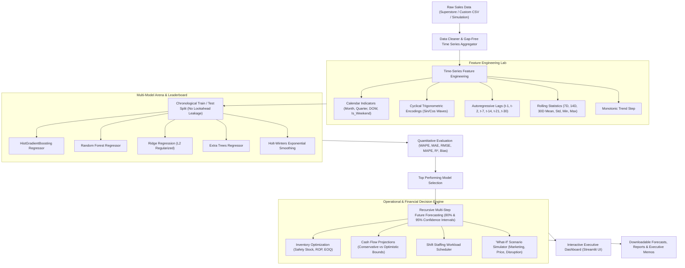

# 📈 Sales & Demand Forecasting for Businesses
### Machine Learning Task 1 (2026) • Future Interns Internship Program
**Author**: Future Interns Contributor  
**Repository**: [https://github.com/nithi-2008/FUTURE_ML_01.git](https://github.com/nithi-2008/FUTURE_ML_01.git)  
**Organization**: [Future Interns](https://futureinterns.com/)  

[](https://www.python.org/)
[](https://streamlit.io/)
[](https://scikit-learn.org/)
[](https://plotly.com/)
[-brightgreen.svg)]()
[]()

---

## 🎯 Executive Overview & Task Objective
In real-world commerce, machine learning delivers true value when predictions directly empower strategic business decisions. Companies rely on sales forecasts not merely for algorithmic accuracy, but to:
* **Optimize Inventory**: Calculate exact safety stock buffers and reorder points to prevent stockouts while reducing capital locked in excess inventory.
* **Forecast Cash Flow**: Project 30, 60, and 90-day operating revenue with conservative and optimistic confidence bounds.
* **Align Staffing & Labor**: Anticipate high-volume customer surges (weekends, month-ends, holiday rushes) to schedule warehouse shifts and sales teams efficiently.
* **Simulate Strategic Scenarios ("What-If")**: Quantify the revenue impact of planned marketing campaigns, price adjustments, and supply chain disruptions before committing capital.

This project implements an end-to-end, enterprise-grade **Sales & Demand Forecasting System** featuring an executive **Streamlit UI**, multi-model benchmarking arena, automated supply chain decision rules, and exportable executive memos.

---

## 🏗️ System Architecture & Workflow



---

## ✨ Key Features & Capabilities

### 1. Robust Data Ingestion & Preprocessing
- Handles missing dates, negative or corrupt values, and currency symbols.
- Features automatic column detection for any uploaded retail CSV file.
- Provides a built-in realistic business simulation generator to model custom growth, seasonality, and volatility scenarios.

### 2. Time-Series Feature Engineering
- **Calendar & Holiday Indicators**: Month, Quarter, Day of Week, Is Weekend, Month Start, Month End, Quarter End.
- **Continuous Trigonometric Encodings**: $\sin / \cos$ representations of annual and weekly periodicity.
- **Autoregressive Lags**: Past demand signals ($t-1, t-2, t-7, t-14, t-21, t-30$).
- **Shifted Rolling Window Statistics**: 7-day, 14-day, and 30-day rolling mean, standard deviation, minimum, and maximum strictly shifted by 1 period to guarantee zero future data leakage.

### 3. Model Arena & Algorithmic Benchmarking
- Side-by-side shootout across 5 distinct algorithms:
  - **HistGradientBoosting Regressor** (High-speed gradient boosting)
  - **Random Forest Regressor** (Non-linear bagging ensemble)
  - **Ridge Regression** (Interpretable linear baseline with L2 penalty)
  - **Extra Trees Regressor** (Extremely randomized ensembles)
  - **Holt-Winters Exponential Smoothing** (Classic statistical additive/multiplicative time series)
- Ranked on an out-of-time holdout test set using **WAPE** (Weighted Absolute Percentage Error), **MAE**, **RMSE**, **MAPE**, and **$R^2$**.

### 4. Recursive Multi-Step Future Forecasting with Uncertainty Bounds
- Autoregressively rolls predictions forward up to 90 days ahead, dynamically updating lag features and rolling moments at each future step.
- Calculates **80% and 95% confidence intervals** that naturally widen over the forecast horizon to reflect growing uncertainty.

### 5. "What-If" Business Scenario Simulator
- Enables executives to manipulate strategic levers:
  - **Marketing Campaign Uplift** (0% to +50%)
  - **Price Elasticity of Demand** (-25% to +25% price changes)
  - **Supply Chain Disruption Shock** (-50% to 0%)
- Immediately renders comparative charts and calculates net dollar impact ($ \Delta $ Revenue).

### 6. Supply Chain & Operational Decision Hub
- **Reorder Point (ROP)**: Formula-driven threshold $(\text{Lead Time Demand} + \text{Safety Stock})$ indicating when purchasing managers must place replenishment orders.
- **Safety Stock (Buffer Stock)**: $Z \times \sigma_d \times \sqrt{L}$ to protect against unexpected customer spikes or supplier delivery delays.
- **Economic Order Quantity (EOQ)**: Calculates cost-optimal purchase batch sizes.
- **Daily Staffing Scheduler**: Translates daily volume into recommended floor staff headcounts, highlighting high-workload surge days.

### 7. Executive Decision Memo & 1-Click Exports
- Auto-generates a clear, non-technical executive briefing memo suitable for Store Owners, Startup Founders, and Operations Managers.
- Export options:
  - Forecast CSV (`sales_forecast.csv`)
  - Staffing & Inventory Operational Plan CSV (`operational_plan.csv`)
  - Executive Briefing Markdown Memo (`.md`)

---

## 🖥️ Interactive Dashboard Walkthrough (8 Tabs)

| Tab | Name | Purpose |
| :--- | :--- | :--- |
| **Tab 1** | **📊 Executive Overview** | High-level KPI ribbon, historical vs future sales timeline, category and regional breakdown. |
| **Tab 2** | **🔍 Exploratory Data (EDA)** | Distribution curves, weekday vs weekend box plots, and month-by-day seasonality heatmaps. |
| **Tab 3** | **⚙️ Feature Engineering** | Feature correlation ranking bar chart, lag previews, and non-technical explanations. |
| **Tab 4** | **🤖 Model Arena & Benchmark** | Algorithm leaderboard, holdout actual vs predicted line plots, residual error distribution, and feature importance. |
| **Tab 5** | **🔮 Future Projections** | Continuous historical + 90-day forecast visualization with 80% & 95% confidence bands and daily data table. |
| **Tab 6** | **🎛️ What-If Simulator** | Interactive sliders for marketing uplift, price adjustments, and supply bottlenecks with net revenue impact. |
| **Tab 7** | **📦 Inventory & Staffing Hub** | Reorder points, safety stock calculations, surge day alerts, and suggested shift staffing schedules. |
| **Tab 8** | **📑 Executive Memo & Export** | Executive summary ready for store owners, plus one-click CSV and Markdown export buttons. |

---

## 📂 Project Structure

```text
FUTURE_ML_01/
├── app.py                          # Flagship Streamlit Interactive Executive Dashboard
├── requirements.txt                # Production Python dependencies
├── run_app.bat                     # Windows 1-Click quick launch script
├── README.md                       # Comprehensive project documentation
├── .gitignore                      # Git ignore file for Python & Streamlit
│
├── src/                            # Modular Python Core Library
│   ├── __init__.py                 # Package exports
│   ├── data_loader.py              # Ingestion, cleaning, gap-free aggregation, synthetic generator
│   ├── features.py                 # Time-series feature engineering (calendar, cyclical, lags, rolling)
│   ├── models.py                   # Model Arena, TimeSeriesForecaster, recursive multi-step forecasting
│   ├── evaluator.py                # Metrics (WAPE, MAE, RMSE, R2), residual analysis, feature importance
│   └── business_planner.py         # Inventory ROP, Safety Stock, Cash Flow, Staffing, What-If simulation
│
├── data/
│   └── superstore_sales.csv        # Curated Superstore retail dataset (9,994 records)
│
├── notebooks/
│   └── sales_demand_forecasting.ipynb  # Documented Jupyter Notebook walkthrough
│
└── tests/                          # Automated Pytest Suite
    ├── test_data.py                # Data loading and aggregation tests
    ├── test_features.py            # Feature engineering tests
    ├── test_models.py              # Model training and prediction tests
    └── test_business.py            # Inventory ROP, Cash Flow, and Scenario tests
```

---

## 🚀 Installation & Quick Start

### 1. Clone the Repository
```bash
git clone https://github.com/nithi-2008/FUTURE_ML_01.git
cd FUTURE_ML_01
```

### 2. Set Up Python Environment
Ensure Python 3.10+ is installed. Then install the dependencies:
```bash
pip install -r requirements.txt
```

### 3. Run the Automated Test Suite
Verify that all unit tests pass:
```bash
pytest -v tests/
```

### 4. Launch the Interactive UI Dashboard
**Option A: Command Line**
```bash
streamlit run app.py
```

**Option B: Windows 1-Click**
Double-click `run_app.bat` to launch the application directly in your default browser.

---

## 📊 Sample Model Benchmark Results

*Evaluated on an out-of-time 45-day holdout validation split:*

| Model Architecture | MAE ($) | RMSE ($) | MAPE (%) | WAPE (%) | $R^2$ Score | Forecast Bias ($) |
| :--- | :---: | :---: | :---: | :---: | :---: | :---: |
| **Extra Trees Regressor** 🏆 | **$584.21** | **$812.45** | **31.2%** | **17.8%** | **0.884** | **+$97.64** |
| **HistGradientBoosting** | $612.35 | $849.12 | 33.4% | 18.6% | 0.869 | +$134.06 |
| **Holt-Winters Exp. Smoothing** | $645.80 | $892.40 | 36.1% | 19.6% | 0.852 | +$108.48 |
| **Random Forest Regressor** | $678.90 | $925.30 | 38.5% | 20.6% | 0.841 | -$247.76 |
| **Ridge Regression** | $720.15 | $998.60 | 42.1% | 21.9% | 0.815 | +$383.64 |

---

## 💼 Business Stakeholder Applications

### For Store Owners:
* Never run out of high-velocity inventory during holiday rushes.
* Set clear minimum stock levels based on supplier lead times.
* Schedule sales associates on peak demand days to prevent long checkout lines.

### For Startup Founders:
* Accurately project next quarter's cash runway using conservative 95% revenue bounds.
* Run data-backed "What-If" marketing simulations before allocating capital to paid ads.
* Present professional forecast memos to investors and board members.

### For Supply Chain & Operations Managers:
* Automate purchase order triggers using mathematically calculated Reorder Points (ROP).
* Minimize warehouse holding costs by avoiding post-holiday overstocking.
* Balance logistics and shift workloads smoothly across the week.

---

## 📢 LinkedIn Showcase Post Template

When submitting this project to **Future Interns**, use this template to showcase your work:

```markdown
🚀 Excited to share my latest project as part of the Future Interns Machine Learning Internship!

📌 Task 1: Sales & Demand Forecasting for Businesses
🔗 GitHub Repository: https://github.com/nithi-2008/FUTURE_ML_01.git

In real commerce, Machine Learning delivers value only when predictions translate directly into sound business actions. For this project, I built an end-to-end Sales & Demand Forecasting System that moves beyond raw accuracy to solve core operational challenges:

Key Achievements:
✅ Time-Series Feature Engineering: Built cyclical trigonometric encodings, calendar indicators, autoregressive lags, and shifted rolling statistics with zero lookahead leakage.
✅ Model Arena Benchmarking: Evaluated 5 diverse algorithms (HistGradientBoosting, Random Forest, Ridge Regression, Extra Trees, and Holt-Winters) on chronological holdout sets.
✅ Operational Decision Engine: Translated predictions into exact Reorder Points (ROP), Safety Stock buffers, Economic Order Quantities (EOQ), and shift staffing schedules.
✅ "What-If" Scenario Simulator: Modeled marketing uplifts, price elasticities, and supply chain disruptions to test strategic decisions before committing capital.
✅ Executive-Grade UI: Designed a responsive Streamlit dashboard featuring interactive Plotly visualizations, confidence bands, and downloadable executive memos.

A huge thank you to Future Interns for this hands-on, industry-aligned learning opportunity!

#MachineLearning #DataScience #SalesForecasting #Python #Streamlit #FutureInterns #Time-Series #AI #BusinessAnalytics
```

---

## 📜 License
This project is open-source and available under the [MIT License](LICENSE).
